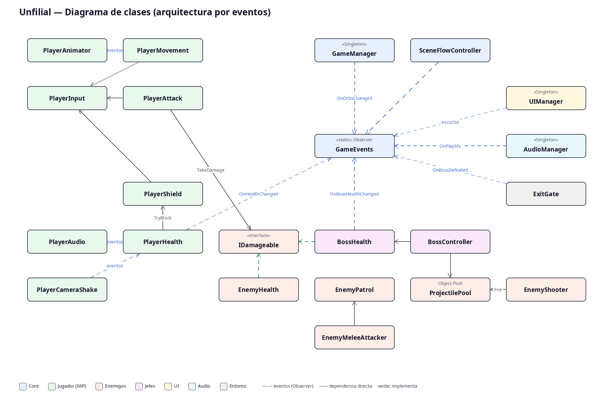
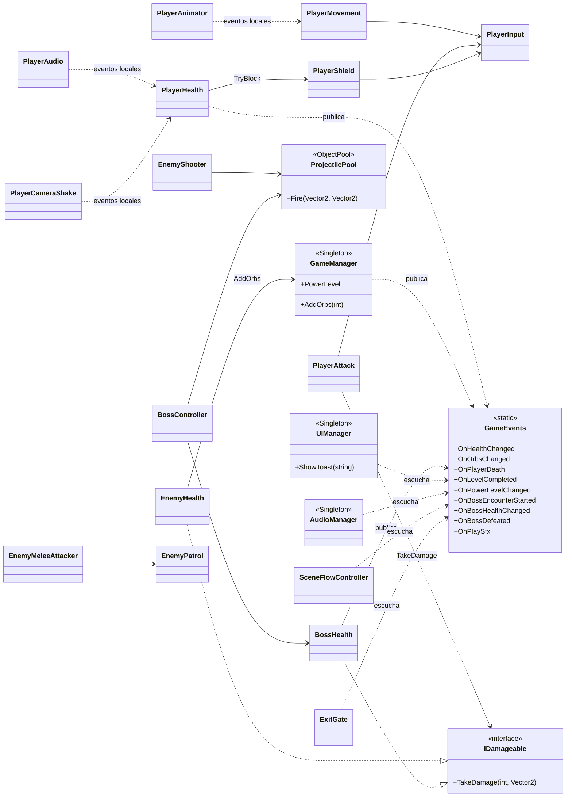

# Informe técnico — Unfilial (Hito 2)

## 1. Datos generales

| Campo | Detalle |
|---|---|
| Asignatura | Desarrollo de Videojuegos — Evaluación Parcial (Hito 2) |
| Proyecto | Unfilial — metroidvania 2D de acción y plataformas |
| Motor | Unity 6 (6000.5.10f1), URP 2D, C# |
| Docente / NRC / Fecha | (completar) |
| Integrantes | (completar con los nombres del equipo) |
| Repositorio | https://github.com/vJos13/Unfilial |
| Build jugable | WebGL: (pegar enlace publicado) · Windows .exe · Linux |

## 2. Descripción del videojuego

Unfilial es un metroidvania 2D inspirado en el «game feel» de Hollow Knight. El jugador controla a un semidiós que atraviesa tres niveles (Ruinas Olvidadas, Cavernas de Ceniza y Templo Celestial), cada uno cerrado por un jefe final. Los orbes recolectados aumentan el poder del personaje: cada 15 orbes sube un nivel de poder y el daño de la espada.

| Acción | Control |
|---|---|
| Mover / apuntar arriba-abajo | A / D · W / S |
| Saltar (doble salto) | Espacio |
| Dash | Shift |
| Atacar (frente, arriba, abajo con rebote «pogo») | J / clic izquierdo |
| Escudo frontal (3 cargas, se rompe si se abusa) | K / clic derecho |
| Pausa | Esc |

## 3. Ciclo de juego (Game Loop)

| Etapa | Implementación |
|---|---|
| Inicio | Escena MainMenu: Jugar, Menú (selección de los 3 niveles), Sonido (opciones de Música y SFX) y Salir. |
| Gameplay | 3 niveles con Tilemaps; combate (ataque direccional, escudo, dash, pogo); enemigos con IA: Crawler y Brute (patrulla, persecución y embestida), Vigía (disparo con Object Pool) y 3 jefes con fases. |
| Desenlace | Derrota: la vida llega a 0 o se cae al vacío → «HAS CAÍDO» y recarga de la escena (los orbes vuelven al valor de inicio del nivel). Victoria: derrotar al jefe abre el portal → «NIVEL COMPLETADO» → siguiente nivel; tras el nivel 3 se vuelve al menú principal. |
| Feedback | HUD (vida, orbes, poder, barra del jefe), música y 14 SFX por Audio Mixer, partículas VFX_HitImpact, flash rojo de daño, screen shake (Cinemachine Impulse), i-frames con parpadeo, hit-flash en enemigos. |

## 4. Arquitectura de software

La comunicación entre sistemas se resuelve con un canal de eventos global (GameEvents, patrón Observer). Jugador, enemigos, UI y audio no se referencian entre sí: publican o escuchan eventos. Dentro del jugador, cada módulo tiene una sola responsabilidad y expone eventos C# locales (Jumped, Attacked, Damaged, Blocked...) que consumen PlayerAudio, PlayerAnimator y PlayerCameraShake.

| Patrón | Dónde | Por qué |
|---|---|---|
| Singleton | GameManager, AudioManager (DontDestroyOnLoad) y UIManager (de escena) | Estado y servicios únicos accesibles sin buscar objetos; los duplicados se destruyen al recargar escenas. |
| Observer | GameEvents + eventos C# locales | Desacopla emisores y receptores: la UI no conoce al jugador y el audio no conoce a los enemigos. |
| Object Pool | ProjectilePool (UnityEngine.Pool.ObjectPool<Projectile>) | Reutiliza proyectiles con Get()/Release() y evita Instantiate/Destroy en cada disparo (menos Garbage Collector). |
| Interfaz / polimorfismo | IDamageable (EnemyHealth, BossHealth) | El ataque del jugador daña cualquier cosa dañable sin conocer su tipo. |
| Datos sobre código | Mapas .txt + UnfilialBuilder (Editor) | Los niveles se describen como datos y el constructor genera escenas, prefabs y assets de forma reproducible. |

| Principio SOLID | Evidencia en el proyecto |
|---|---|
| S — Responsabilidad única | El jugador está dividido en 8 componentes (Input, Movement, Attack, Shield, Health, Animator, Audio, CameraShake). |
| O — Abierto/cerrado | Nuevos enemigos implementan IDamageable sin modificar PlayerAttack; nuevos sonidos se añaden a SfxType sin tocar a quien los dispara. |
| L — Sustitución de Liskov | EnemyHealth y BossHealth son intercambiables donde se espera un IDamageable. |
| I — Segregación de interfaces | IDamageable expone un único método; cada sistema escucha solo los eventos que necesita. |
| D — Inversión de dependencias | Los sistemas dependen de la abstracción GameEvents y no entre sí (sin dependencias circulares). |

## 5. Sistemas 2D avanzados

- Tilemaps: Grid 1×1 con 3 capas: Background_Tilemap (decorativa), Ground_Tilemap (capa Ground, Tilemap Collider 2D fusionado en un Composite Collider 2D con Rigidbody 2D estático) y Hazards_Tilemap (pinchos con trigger).
- Tileset de 16 tiles con auto-tiling por bordes expuestos, más tile agrietado, pinchos y 2 de fondo; paleta guardada en Art/Palettes.
- Cinemachine: CM vcam1 con Position Composer (lookahead 0.15, damping 0.6/0.4, zona muerta 0.15), Confiner 2D con los límites del nivel e Impulse Listener para el screen shake.
- Animator del jugador: 11 estados (Idle, Run, Jump, Fall, Attack, AttackUp, AttackDown, Block, Dash, Hurt, Death); parámetros Speed, IsGrounded, yVelocity, IsBlocking, AttackDir y triggers Attack, Hurt, Dash y Death; transiciones reactivas sin Exit Time y con duración 0.
- Sprites pixel art importados como Multiple, 32 PPU, filtro Point y sin compresión. Jefes con Animator propio (7 animaciones).

## 6. Experiencia de usuario: UI, audio y partículas

- Canvas Screen Space Overlay con Canvas Scaler 1920×1080 (match 0.5) y EventSystem con el nuevo Input System.
- HUD: barra de vida Image Filled (horizontal, origen izquierdo) arriba a la izquierda; contador de orbes TMP con Auto Size arriba a la derecha; nivel de poder; barra del jefe.
- Menú de pausa (Esc) con Time.timeScale = 0, opciones de sonido y salida al menú principal.
- Audio Mixer MainMixer con grupos Music/SFX y parámetros expuestos MusicVol/SFXVol (conversión logarítmica Log10·20). SFX con Decompress On Load y música con Streaming + Vorbis; variación de tono 0.9–1.1.
- Partículas VFX_HitImpact: ráfaga en t = 0, duración 0.5 s, vida 0.3 s, Stop Action = Destroy, instanciadas en el punto de impacto.

## 7. Game feel

- Gravedad asimétrica al caer, doble salto, dash con cooldown y rebote «pogo» al golpear hacia abajo.
- Escudo frontal con cargas que ralentiza al jugador; los proyectiles también se bloquean.
- Invulnerabilidad temporal (i-frames) con parpadeo, flash rojo de pantalla y screen shake al recibir daño.
- Enemigos con knockback, aturdimiento y destello al ser golpeados; ataques telegrafiados (pose + color) para poder reaccionar.
- Jefes con rugido, sacudida de cámara, segunda fase al 50% de vida y animación de muerte.

## 8. Gestión y control de versiones

El proyecto se versiona en GitHub con commits semánticos (feat, chore, refactor) y una etiqueta pre-audio-merge como respaldo previo a la integración del audio. Los assets generados (Library, Builds, Temp) se excluyen con .gitignore.

## 9. Autoevaluación frente a la rúbrica

| Criterio | Lo que se cumple | Pendiente para «Excelente» |
|---|---|---|
| Ingeniería y arquitectura | Singleton, Observer, Object Pool, interfaz IDamageable, SRP en el jugador, comentarios con el «porqué». | Patrón State explícito (clases de estado) para la IA o el jugador; hoy se usan corrutinas y la FSM del Animator. |
| Game feel y físicas | Screen shake, partículas, SFX sincronizados, i-frames y cámara Cinemachine con límites. | Coyote time e input buffering en el salto. |
| Implementación técnica 2D | Tilemaps por capas con Composite Collider, Animator con 11 estados, UI anclada y responsiva. | Blend Tree (por ejemplo Idle/Run según Speed) y transiciones animadas entre menús. |
| Ciclo de juego | Inicio, victoria (jefe y portal), derrota con recarga limpia y regreso al menú. | Pantalla final de victoria tras el nivel 3. |
| Defensa, colaboración y Git | Historial con commits semánticos y etiqueta de respaldo. | Ramas y pull requests, con commits de todos los integrantes. |

## 10. Guion sugerido para la defensa (7–10 min)

| Tiempo | Contenido |
|---|---|
| 0:00 – 1:00 | Presentación del concepto, del equipo y de los controles. |
| 1:00 – 4:00 | Demo en vivo: menú → nivel 1 (combate, escudo, orbes, poder) → jefe → portal → Game Over y reinicio. |
| 4:00 – 6:30 | Arquitectura: diagrama de clases, GameEvents (Observer), Singletons, SRP del jugador, IDamageable y Object Pool. |
| 6:30 – 8:30 | Sistemas 2D: Tilemaps por capas, Cinemachine e Impulse, Animator y Audio Mixer. |
| 8:30 – 10:00 | Decisiones técnicas, dificultades, mejoras futuras y preguntas. |

## 11. Créditos y licencias

- Sprites del personaje y de los jefes: generados con scripts Python/Pillow (SpriteGen/) creados con ayuda de IA (Claude).
- Tileset, enemigos, orbes y efectos: generados por código en UnfilialBuilder.cs.
- Música y SFX: sintetizados por código (ProceduralAudio.cs) y exportados a .wav.
- Fuente LiberationSans SDF (TextMesh Pro, SIL Open Font License 1.1).
